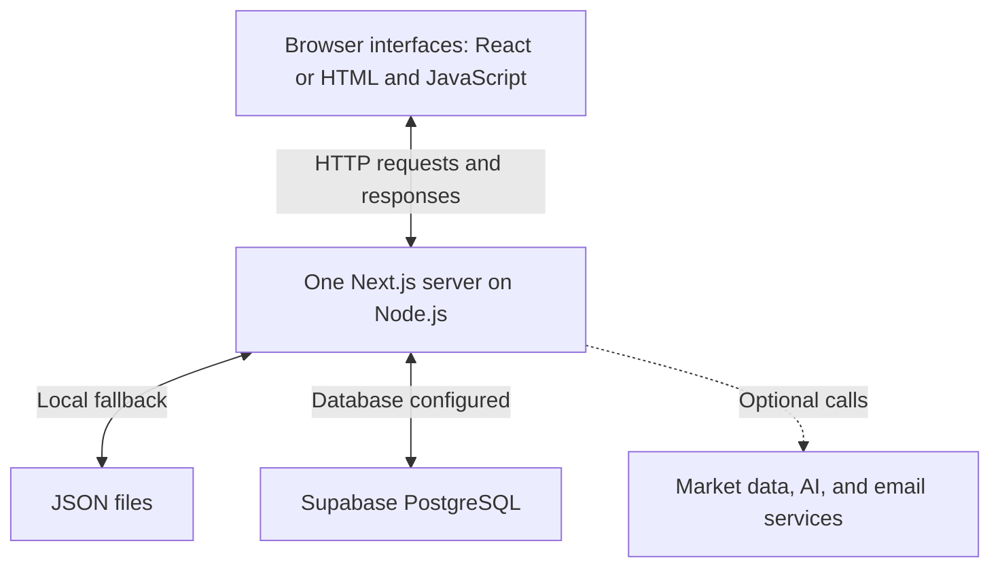
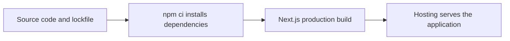

# 1. Stack and infrastructure

[Guide home](README.md) · Next: [data flow](02-data-flow.md)

The **stack** is the software used to build and run the app. **Infrastructure** is where it runs, stores data, and performs automated work.

## How the pieces fit

The Next.js server contains the API routes, session checks, trading logic, and storage functions. These are parts of one application, not a collection of separately deployed microservices. Branden's CF PDF and IBKR XML statements are parsed and reconciled on the server. Cam's CSV parser groups and merges executions in the browser before saving.

| Technology | Its job in this project |
| --- | --- |
| TypeScript and JavaScript | Languages used for application code and tests. TypeScript adds checks on data types. |
| React | Builds Branden's interface and the monthly-report interface. |
| Next.js | Organizes pages, serves the app, and handles API routes. |
| Node.js | Runs server code, development tools, and test runners. |
| Supabase PostgreSQL and `pg` | Supabase hosts the database; the Node `pg` library reads and writes PostgreSQL records. |
| JSON files | Development/demo storage when no database is configured. |
| Recharts and lightweight-charts | Display dashboard and market charts. |
| Node test runner and Playwright | Execute different layers of automated tests. |

## How source becomes a running application

`npm run dev` serves the app while developing. `npm run build` creates the optimized production build. Vercel performs its own deployment build; the separate build in GitHub Actions is a verification check and does not publish its output.

## Hosting and external services

- **GitHub:** stores versioned source code, PRs, and test fixtures. **GitHub Actions** provides temporary machines for automated checks.
- **Vercel:** the existing deployment platform for this Next.js project. Connected Git integration has produced branch deployments. Exact production and preview settings still need confirmation; see [environments](05-environments.md).
- **Supabase:** hosts the deployed PostgreSQL database, as confirmed by the project owner. The server connects using `pg` and `DATABASE_URL`. PostgreSQL is the database engine; Supabase is its hosting provider. The generic connection code does not require a Supabase SDK.
- **Optional integrations:** Alpaca, Stooq, and Yahoo supply market data; OpenAI supports AI reviews; an SMTP server supports snapshot email. Import tests do not require these live services.
- **Scheduled work:** `vercel.json` declares market-context archiving and Cam backup calls. Their endpoints require cron authorization; the configuration alone does not prove successful scheduled execution.

## Where to look later

[Dependencies and commands](../../package.json) · [API routes](../../app/api/) · [Storage](../../lib/store.ts) · [Cam interface](../../public/cam-journal/) · [Vercel schedule configuration](../../vercel.json)

Authentication uses the application's signed-session cookies; using Supabase for database hosting does not mean this app uses Supabase Auth. Exact setup, versions, credentials, and integration limitations are in the [application reference](../../README.md).
