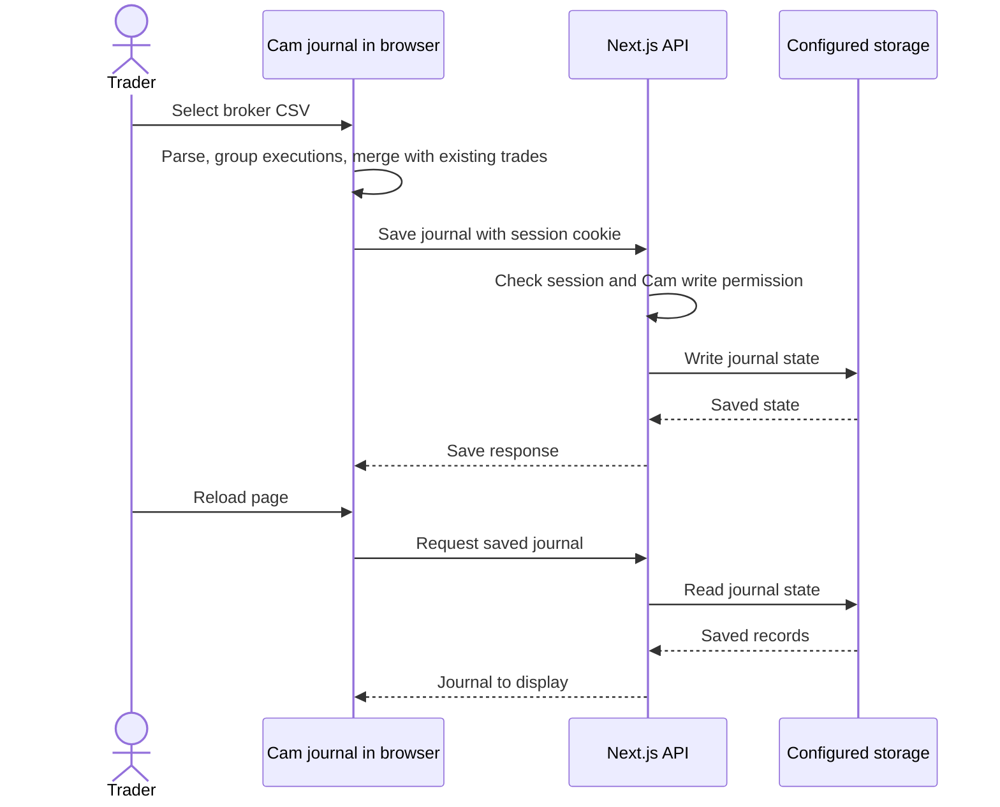

# 2. From statement to saved trade

[Guide home](README.md) · Previous: [stack](01-stack-and-infrastructure.md) · Next: [testing](03-testing.md)

Cam's broker import is a useful example because it crosses the browser, server, and storage boundaries.

The browser can display a calculated result before the server save finishes. That is why a meaningful test checks the page, waits for the save response, and inspects saved data. A fresh browser also checks recovery without relying on the original browser's cache.

## Our synthetic example

The [fixture](../../e2e/fixtures/synthetic-schwab.csv) buys ten XYZ shares at $100, sells them at $103, and includes $2 in fees. The independently calculated result is **one completed trade, two executions, and $28 profit**.

After saving a manual note and a $98 stop, uploading that statement again should preserve the saved trade and both edits. Duplicate detection uses execution identities, not just the number of visible rows.

## What is actually saved?

Cam saves the journal as a whole, including its trades and annotations:

- **Local JSON:** `camJournalState` inside `app-settings.json`.
- **PostgreSQL:** a JSON value in `app_settings` under the key `cam_journal_state`. The save path also keeps previous states in `cam_journal_revisions`.

Other application records use their own storage structures. A Cam trade is not necessarily a separate PostgreSQL row for every trade and execution.

The browser caches data in localStorage too. That cache is different from the server's saved copy. Whole-state saves still have a lost-update risk when multiple browsers edit concurrently; the current browser tests do not establish concurrency correctness.

Login creates a signed session cookie. Protected routes check it; Cam's write route requires the `cam` identity. This is a shared-journal permission model, not a claim that every application route is private. See the [authentication reference](../../README.md#stack-and-data-flow) for its limits.

## Where to look later

[CSV parser](../../public/cam-journal/broker-csv-parser.js) · [Browser import/save code](../../public/cam-journal/app.js) · [Cam API](../../app/api/cam-journal/route.ts) · [Storage](../../lib/store.ts)
