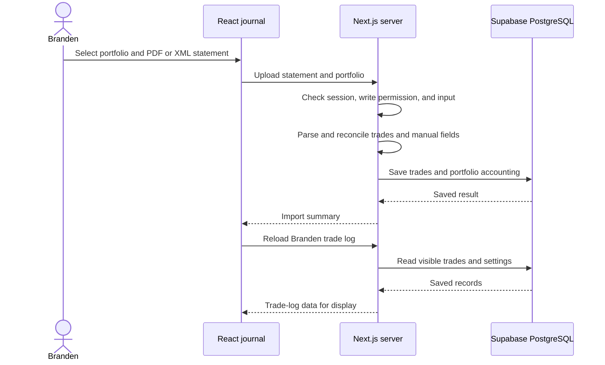
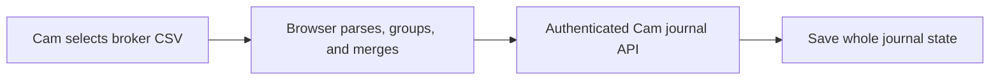

# 2. Branden's data flow, with a Cam comparison

[Guide home](README.md) · Previous: [stack](01-stack-and-infrastructure.md) · Next: [testing](03-testing.md)

Both journals use the same server and Supabase-hosted PostgreSQL database, but they process imports and save records differently. Branden's journal is the primary example here.

## Branden: statement import and trade-log reload

In Branden's React interface, choose a portfolio and a supported CF PDF or IBKR Flex XML statement. The browser uploads the file; the server parses it, reconciles executions with existing records, and applies the import's manual-field preservation rules. This diagram shows the deployed Supabase path; the local fallback is described below.

The upload uses `POST /api/import/cf-statement`; despite its name, that endpoint handles both supported file types. Branden's trade-log page reloads data through `GET /api/journal/branden/trade-log`.

Manual trade edits, such as notes, reflections, and stop prices, are saved through `PUT /api/trades/:id`. The server checks the session and write permissions, validates required fields, and updates the owned trade. Reimport preservation is implemented in the broker-specific reconciliation logic; browser coverage of Cam's import does not prove Branden's entire workflow.

## Where Branden's data is saved

- **Supabase PostgreSQL:** individual trades are rows in `trade_logs`. Each row includes fields such as user, portfolio, prices, stop, notes, and executions; some structured fields use JSON. Portfolio settings and broker snapshots use their own storage helpers and records.
- **Local JSON fallback:** trades are in `trade-logs.json`; settings are in `app-settings.json`. This path is used without a configured database outside production.

The server reaches Supabase using the Node `pg` library and `DATABASE_URL`. Database hosting does not replace the application's own session and permission checks.

## Cam: browser parsing and whole-journal saves

Cam uses `PUT /api/cam-journal` to save the journal as a whole. In Supabase PostgreSQL, that state is a JSON value in `app_settings` under `cam_journal_state`, with previous states in `cam_journal_revisions`. Locally it is `camJournalState` inside `app-settings.json`.

Cam also caches records in browser localStorage. That cache differs from the server copy, and whole-state saves still have a lost-update risk with concurrent editors. The [two-execution, $28 CSV fixture](../../e2e/fixtures/synthetic-schwab.csv) belongs to Cam's current browser test; it is not a Branden PDF/XML fixture.

## What to verify in either journal

Check the displayed result, the successful save response, and the saved records. Reloading with a fresh browser checks recovery without relying on the original browser's state. Verify quantities, prices, fees, execution identities, account/portfolio boundaries, and preservation of the intended manual fields. PostgreSQL integration coverage remains the next planned exercise.

## Where to look later

**Branden:** [Import UI](../../app/journal/branden/BrandenJournalLayoutClient.tsx) · [Import API](../../app/api/import/cf-statement/route.ts) · [Trade-log API](../../app/api/journal/branden/trade-log/route.ts) · [Trade edit API](../../app/api/trades/[id]/route.ts)

**Shared storage:** [Store functions and schema](../../lib/store.ts)

**Cam:** [CSV parser](../../public/cam-journal/broker-csv-parser.js) · [Browser import/save code](../../public/cam-journal/app.js) · [Cam API](../../app/api/cam-journal/route.ts)
