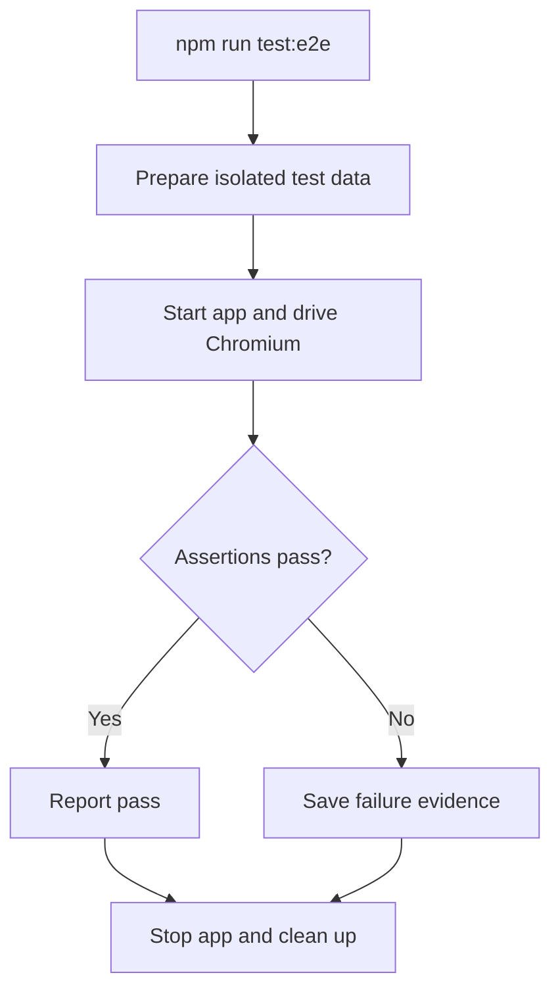

# 3. How testing works

[Guide home](README.md) · Previous: [data flow](02-data-flow.md) · Next: [feature to release](04-feature-to-release.md)

A **scenario** states behavior in plain language. A **fixture** supplies controlled input. A **test script** performs actions, and **assertions** compare actual results with independently chosen expectations.

## The test layers we have

| Layer | What it establishes |
| --- | --- |
| Unit/domain tests | Parsing, calculations, execution grouping, and other focused logic for supplied cases. |
| Local integration and directly invoked route tests | Selected components work together, including temporary JSON storage and handler responses. |
| Mocked-service tests | Code handles prepared market/AI responses and injected email transports. This is not proof of live provider compatibility. |
| Static or extracted UI checks | Particular markup or functions behave as asserted; a complete browser is not exercised. |
| Playwright suite | Two browser workflows and a real HTTP permission case against a local app with JSON persistence. |
| Manual exploratory and acceptance checks | A person investigates workflows and checks intended user needs; record what was actually checked. |

**Planned next:** a focused PostgreSQL integration test. The current suites do not establish PostgreSQL transaction, schema-change, or concurrent-write correctness.

## What happens when we run Playwright?

The launcher creates test credentials and storage; Playwright reads its configuration to start the app and run the test files. Headless Chromium is a real browser without a visible window. Playwright translates TypeScript tests for execution; type checking is a separate command. API checks and disk reads supplement browser assertions.

| Command, from the application directory | Purpose |
| --- | --- |
| `npm run typecheck` | Check TypeScript types. |
| `npm test` | Run the Node suite under `tests/`. |
| `npm run test:e2e` | Run the Playwright suite under `e2e/`. |
| `npm run build` | Check that the production application builds. |

The launchers clear inherited database/provider/SMTP settings. Browser runs create disposable storage and use the real login API. Tests use synthetic records and avoid production data or paid service calls.

## Reading and maintaining results

An unhappy-path test **passes** when an error is handled correctly. A red result means an expectation and observation differ; investigate the application, test, fixture, or environment. Our lesson's deliberately wrong $29 expectation was a test mistake: the correct fixture result remains $28.

Keep tests while they protect supported behavior. Update expectations when requirements intentionally change, add cases for meaningful gaps, and retire obsolete or redundant cases. A green suite establishes its specific assertions, not every acceptance criterion.

The current browser cases cover initial import, preserved edits and execution contents on reimport, fresh-browser recovery, unrecognized-input preservation, and 401/403 responses. See [verification and release](../verification.md) for the mapping and known gaps.

## Where to look later

[Committed browser tests](../../e2e/broker-import.spec.ts) · [Browser launcher](../../scripts/run-browser-tests.mjs) · [Playwright configuration](../../playwright.config.ts) · [Node tests](../../tests/)
