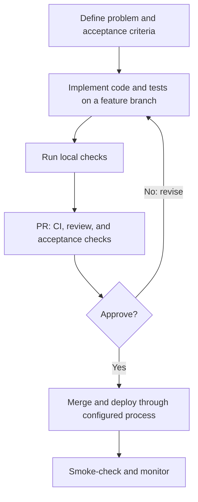
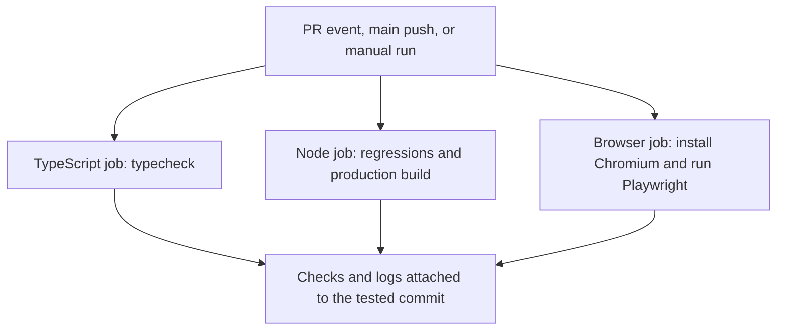

# 4. From feature to release

[Guide home](README.md) · Previous: [testing](03-testing.md) · Next: [environments](05-environments.md)

## The working process

This is a recommended review process, not an automatically enforced release gate. Engineers and QA can share criteria, tests, investigation, and review; one PR can contain contributions from both.

For example: define that reimport preserves notes and stops, implement or inspect the merge logic, add tests with known expected records, and review the actual assertions. User acceptance checks assess whether the intended trader workflow is usable and complete. Smoke checks are a small confirmation that the deployed version works; they do not replace acceptance testing.

## What GitHub Actions currently does

The [workflow file](../../../.github/workflows/verification.yml) is the configuration GitHub reads. It triggers when a PR opens, reopens, or receives commits; when code is pushed to `main`; or when someone manually selects **Run workflow**. Each job gets a fresh runner and installs dependencies from the lockfile.

GitHub runs the tests itself; it does not reuse a local pass result. For PRs, checkout normally retrieves a temporary merge of the proposed changes with the target branch. Unchanged regression tests are already part of that complete project.

New matching tests are discovered automatically: Node scans the top level of `tests/` for files ending in `.test.ts`, `.test.mjs`, or `.test.js`; Playwright discovers test files under `e2e/`, such as `new-workflow.spec.ts`. Add or update them in the feature PR. Change the workflow when execution needs change, such as adding a database test service.

## Finding evidence and releasing

On the PR, open **Checks**, select a job, and expand its test step. Browser failures upload reports, screenshots, and traces as artifacts on the run summary, retained for seven days. Successful runs still have logs; this workflow uploads browser artifacts only on failure.

GitHub Actions here **verifies; it does not deploy**. Vercel's existing Git integration is separate and may build while checks run. Requiring checks before merge and configuring deployment gates are separate settings; this work does not establish either. Confirm production-branch settings before assuming that a merge publishes a release.

Use isolated data for preview/acceptance writes. After release, start with approved read-only smoke checks, then watch relevant logs and customer reports. Deeper procedures and responsibilities belong in [verification and release](../verification.md).
