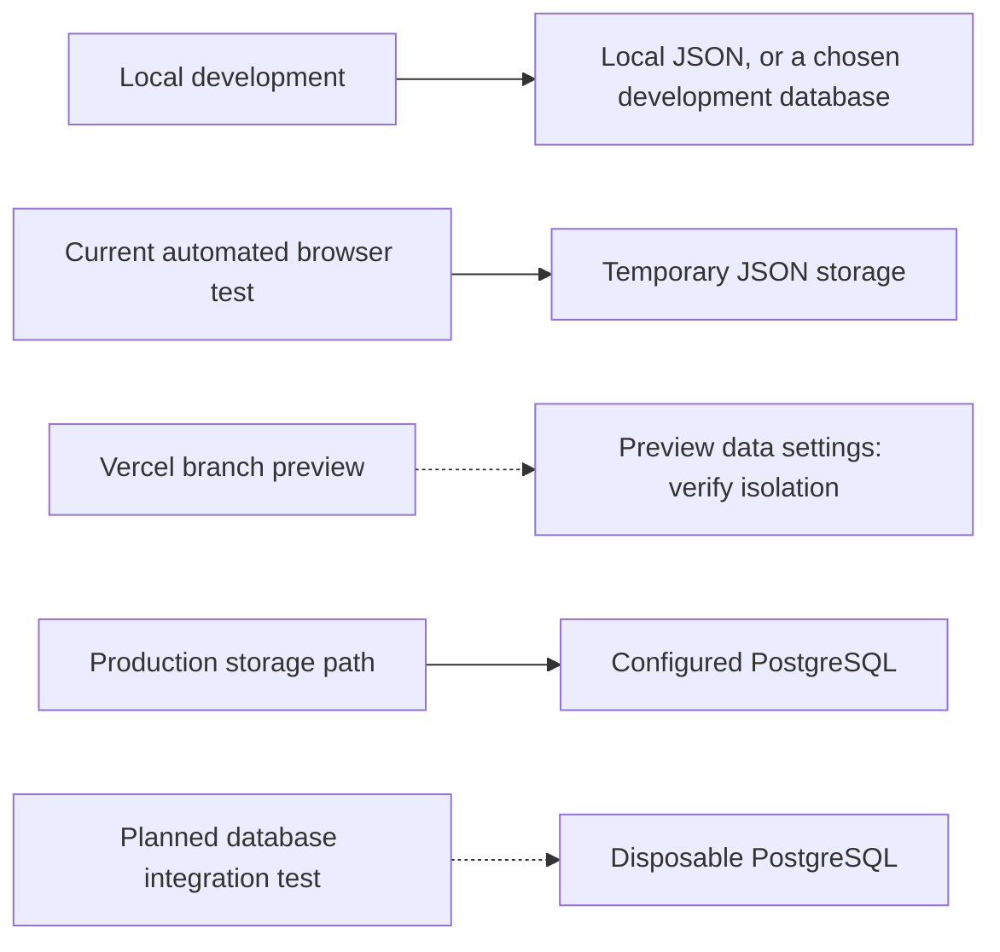

# 5. Environments and deployment

[Guide home](README.md) · Previous: [feature to release](04-feature-to-release.md)

An **environment** is a running application plus its configuration, data, and connected services. A branch is a version of the code. A branch can trigger a deployment, but an environment does not require a branch with the same name.

## Current paths and planned work

Dashed connections identify an unverified configuration or planned addition. The diagram does not assert that the planned test database or a dedicated staging environment already exists.

| Environment | Purpose and current status |
| --- | --- |
| Local development | Build and investigate the app. `npm run dev` normally uses port 3000; JSON is the fallback without `DATABASE_URL`. |
| Automated testing | Existing Node and browser suites use controlled inputs. Playwright starts its own app on port 3100 with temporary JSON storage and random credentials. GitHub Actions runs these checks on fresh machines. |
| Vercel preview | Feature-branch builds were observed in the initial audit. A separate URL does not prove separate data; preview database and service configuration remain unverified. |
| Dedicated staging | A useful possible rehearsal environment; this repository does not establish a staging branch or separately provisioned staging system. |
| Production | The deployed application uses the PostgreSQL storage path for writes. Production branch, database hosting provider, and exact hosting settings need owner confirmation. |
| Planned database testing | Next exercise: verify the real PostgreSQL storage path using disposable synthetic data. No PostgreSQL CI service or integration suite is added yet. |

## How Vercel fits with PRs

A common Vercel process is to build a preview for a feature branch, perform review and acceptance checks there, then merge into the configured production branch for a production deployment. Preview builds and GitHub checks can run in parallel. Production builds use their environment's configuration, so production smoke checks still matter.

A team can instead use a dedicated staging branch/environment. That is a process choice, not a prerequisite for PR previews. Our Actions workflow currently triggers on PR events and `main` pushes, not every push to a hypothetical staging branch.

## What makes an environment separate?

The browser URL identifies a deployment. **Its database, accounts, and service credentials determine which data it can access.** Preview and test writes need isolated data. Server-side environment variables such as `DATABASE_URL`, `APP_SECRET`, and provider keys select those connections; keep values out of source control.

The application is designed for Vercel with root directory `monthly-trading-report`, Node 24.x, and PostgreSQL. These are deployment requirements, not proof that every external setting has been verified. No deployment settings are changed by this guide. See [setup and deployment](../../README.md#delivery-and-deployment) and the [audit](../audit.md) for details and observed evidence.
