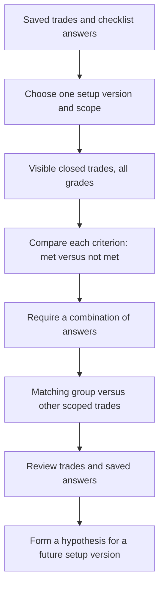

# Strategy Analyzer

Open **Strategy Analyzer** in Branden's sidebar to explore which saved setup conditions are associated with winning and losing trades. It includes all grades, so a winner marked Incomplete can still help you evaluate a rule.

## A first walkthrough

1. Choose a setup/version, portfolio, and optional entry-date range or direction.
2. Find a criterion such as **Trade with trend**. Compare win rate, trade count, and average R when it was met versus not met.
3. Set **Volume confirmed → Met** and **Trade with trend → Not met**. Only trades satisfying both conditions enter the matching group. Unselected criteria can have any answer.
4. Compare matching trades with all scoped trades and the remaining trades. Review the actual symbols, grades, and saved checklist answers below. Symbol and outcome filters affect only this evidence list.
5. Follow a symbol to review its original trade in a new tab, leaving your analysis open. Use findings to inform a future setup version in Setup Builder; the analyzer never edits trades, grades, or setup definitions.

## Reading the results

| Item | Meaning |
| --- | --- |
| Boolean criterion | Met = checked; Not met = unchecked in the saved trade. |
| Point criterion | Met = full points; Not met = below full points, including zero. Use Partial points only to isolate scores between zero and the maximum. |
| Not recorded | No matching saved answer, invalid score, or conflicting duplicate answers. This is separate from an unchecked box. |
| Win rate | Positive-P/L trades divided by all trades in that group, including breakeven. |
| Net P/L | Sum of the journal's saved P/L. Commission is not subtracted again. |
| Average R | Average of saved P/L divided by saved positive risk. Missing risk is excluded from R, with coverage shown beside the figure. |
| Met − not met | Difference in win rate, in percentage points, and average R. A negative gap means the met group performed worse in this sample. |
| Small sample | Fewer than five trades in that group; a reminder to inspect the evidence. |

Each criterion comparison holds your **other** selected criteria fixed and ignores its own row's filter. For example, with Volume → Met and Trend → Not met, the Trend row still compares both trend groups among trades that met Volume. The matching-group figures apply **every** selected condition.

Setup uses the trade's first setup tag. Versions, including archived versions, remain separate. Answers come from saved trade checklists, not today's template defaults. Definitions with changed labels, groups, input types, or maximum points stay separate. No automatic historical backfill is performed.

These are descriptive comparisons. Overlapping conditions, market regimes, position sizing, and repeated filtering can influence the results. A gap can suggest a useful question; it does not establish that removing a criterion will improve future returns.

## How it is built and checked

The React page reads the existing authenticated Branden trade-log API, then computes comparisons locally in `lib/strategy-analyzer.ts`. It makes no analysis writes and needs no database migration or external service.

`tests/strategy-analyzer.test.ts` checks independently calculated results, combined filters, historical definitions, missing answers, points, risk coverage, and scope exclusions. `e2e/strategy-analyzer.spec.ts` saves synthetic setups and trades through the real local APIs, then checks filtering, archived versions, mobile layout, error recovery, and that trade storage remains unchanged. The existing GitHub Actions workflow discovers these tests automatically.
