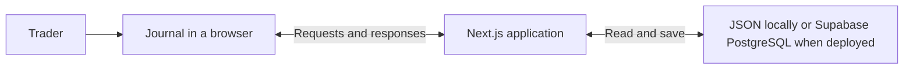

# TradingDashboard: start here

This guide explains the application in plain language before introducing implementation details. Read it in order, or use a page when explaining that part of the project. Mermaid diagrams render directly on GitHub; their source stays editable in these Markdown files.

## The application in one minute

TradingDashboard helps traders connect broker executions with their own notes, risk decisions, setups, and performance reviews. The active application lives in `monthly-trading-report/`; its name comes from the original monthly-report feature.

Branden's journal and monthly reports use React. Cam's journal uses HTML and browser JavaScript. Both use the same Next.js server. GitHub stores the source code and runs automated checks; Vercel hosts the application, and Supabase hosts its deployed PostgreSQL database.

## Reading path

| Page | Question it answers |
| --- | --- |
| [1. Stack and infrastructure](01-stack-and-infrastructure.md) | What technologies do we use, and what does each one do? |
| [2. Data flow](02-data-flow.md) | How do Branden's server-side imports and trade edits work, and how does Cam's flow differ? |
| [3. Testing](03-testing.md) | How do fixtures, test scripts, assertions, and results fit together? |
| [4. Feature to release](04-feature-to-release.md) | What goes into a PR, and how does GitHub run the checks? |
| [5. Environments](05-environments.md) | What differs between development, testing, previews, and production? |

## Current coverage and next step

The repository has Node regression tests, Playwright browser/API checks using isolated JSON storage, and a GitHub Actions verification workflow. **PostgreSQL integration testing is the next planned exercise; it is not implemented by this documentation.** A dedicated staging environment and deployment gates are not established by the repository configuration reviewed here.

AI assisted the project and these documents. The diagrams describe this application, not Deepvue's architecture. Recorded test evidence belongs in the [audit](../audit.md); recommendations and known gaps are identified on the relevant pages.

## Small glossary

| Term | Meaning here |
| --- | --- |
| Frontend | The interface running in the trader's browser. |
| Backend / server | Code that handles requests, permissions, storage, and service calls. |
| API | The request/response interface between programs, such as browser and server. |
| Fixture | Prepared input with a known expected result, such as a synthetic CSV. |
| Assertion | A test instruction that requires a particular result. |
| PR | A pull request proposing changes to the repository. |
| CI | Automated checks that run as changes are integrated. |
| Deployment | A built version of the application made available through hosting. |
| Environment | A running application plus its configuration, data, and connected services. |

For commands and configuration, use the [application reference](../../README.md). For deeper testing and release detail, use [verification and release](../verification.md).
